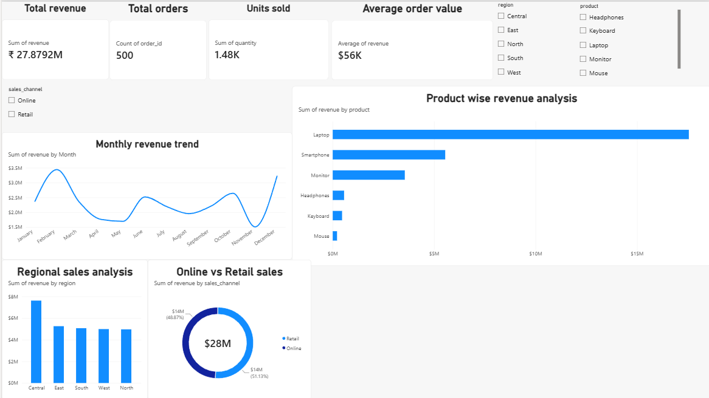

# Retail Sales Data Analysis

## Project Overview
This project analyzes retail sales data using Python, SQL, SQLite and Power BI to identify sales trends, product performance and regional revenue patterns.

## Tools & Technologies
- Python
- Pandas
- Matplotlib
- SQL
- SQLite
- DB Browser for SQLite
- Microsoft Power BI

## Dataset Information
- Total Records: 500
- Total Columns: 9
- Missing Values: 0
- Dataset: Retail Sales Data

## Key Performance Indicators
- Total Revenue: ₹27,879,200
- Total Orders: 500
- Units Sold: 1,480
- Average Order Value: ₹55,758.40

## Analysis Performed
1. Monthly Revenue Trend
2. Product-wise Revenue Analysis
3. Regional Sales Analysis
4. Online vs Retail Sales
5. Overall Business Performance

## Project Files
- analyze_sales.py – Python analysis
- retail_sales.csv – Dataset
- retail_sales.db – SQLite database
- sql_queries.sql – SQL queries
- requirements.txt – Python dependencies
- Retail_Sales_Dashboard.pbix – Power BI dashboard

## How to Run
1. Clone this repository.
2. Install dependencies:
   pip install -r requirements.txt
3. Run:
   python analyze_sales.py
   ## Dashboard Preview

## Author
Nishant Kumar Roshan
B.Tech Information Technology
